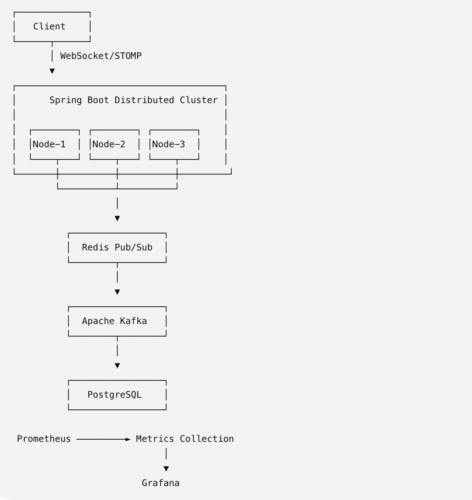
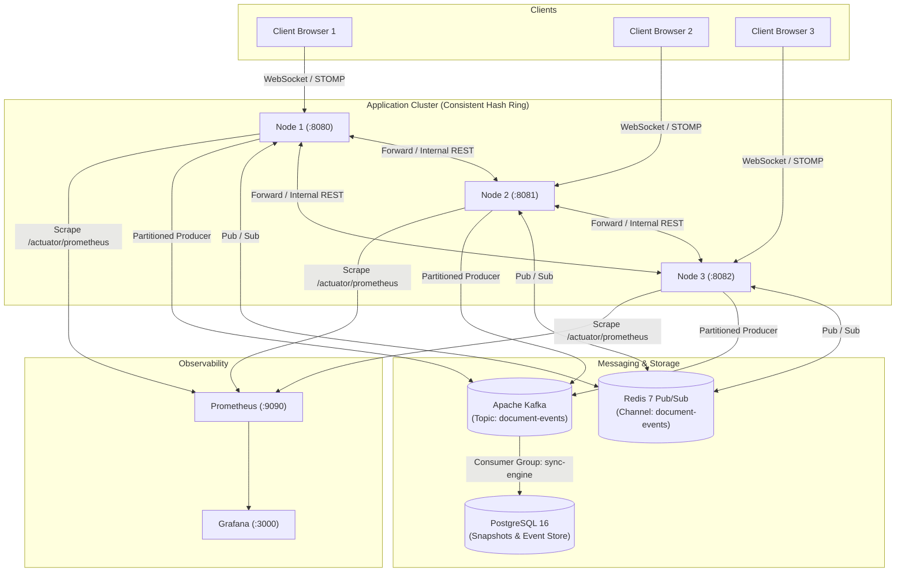
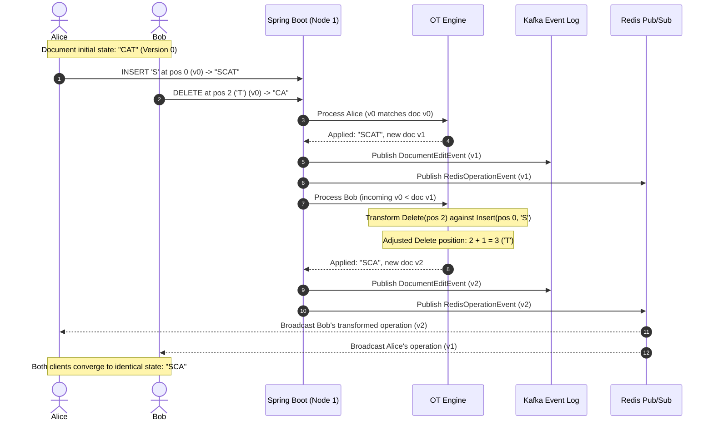
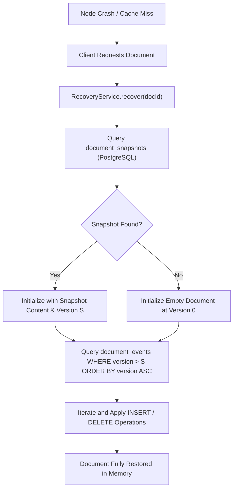
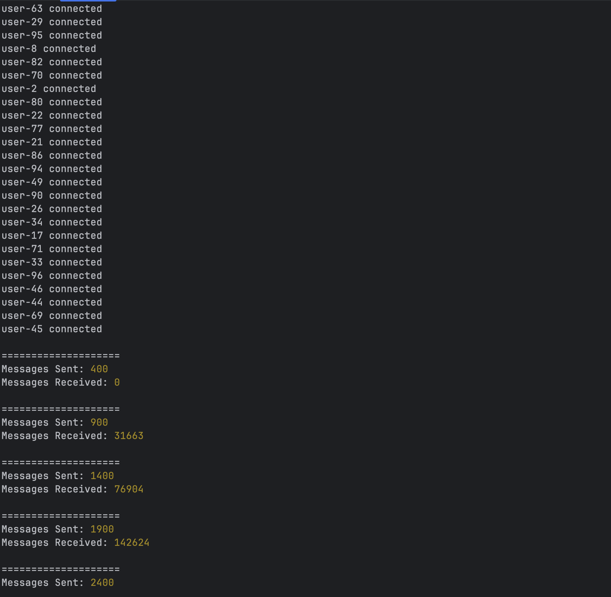

# Real-Time Collaborative Sync Engine

A high-performance, fault-tolerant, horizontally scalable distributed collaborative editing platform built with **Java 21**, **Spring Boot 3.3.5**, **WebSockets (STOMP + SockJS)**, **Redis Pub/Sub**, **Apache Kafka**, **PostgreSQL**, **Prometheus**, and **Grafana**.

The engine allows multiple geographically dispersed users to concurrently view, edit, and interact with live shared documents. Consistency and convergence across distributed nodes are achieved through **Operational Transformation (OT)**, **Consistent Hashing Request Routing**, **Hybrid Event Sourcing with Periodic Snapshots**, and **Multi-Node Redis Pub/Sub Synchronization**.

---

## Table of Contents

1. [High-Level Architecture](#high-level-architecture)
2. [Core Distributed Engineering Concepts](#core-distributed-engineering-concepts)
   - [Operational Transformation (OT) Engine](#1-operational-transformation-ot-engine)
   - [Distributed Consistent Hash Ring & Routing](#2-distributed-consistent-hash-ring--routing)
   - [Hybrid Event Sourcing & Snapshot Recovery](#3-hybrid-event-sourcing--snapshot-recovery)
   - [Cross-Node Synchronization via Redis Pub/Sub](#4-cross-node-synchronization-via-redis-pubsub)
   - [Presence Tracking & Session Lifecycle](#5-presence-tracking--session-lifecycle)
3. [Complete File-by-File Technical Directory](#complete-file-by-file-technical-directory)
   - [Root Infrastructure & Orchestration](#1-root-infrastructure--orchestration)
   - [Kubernetes Manifests (`k8s/`)](#2-kubernetes-manifests-k8s)
   - [Backend Build & Configuration (`backend/`)](#3-backend-build--configuration-backend)
   - [Frontend Client UI (`backend/src/main/resources/static/`)](#4-frontend-client-ui)
   - [Backend Java Source Code (`backend/src/main/java/com/cfs/backend/`)](#5-backend-java-source-code)
     - [Application Entrypoint](#application-entrypoint)
     - [Domain Models (`model/`)](#domain-models-model)
     - [Data Transfer Objects (`dto/`)](#data-transfer-objects-dto)
     - [Clustering & Consistent Hashing (`cluster/`)](#clustering--consistent-hashing-cluster)
     - [Application Configuration (`config/`)](#application-configuration-config)
     - [Core Business Services (`service/`)](#core-business-services-service)
     - [API & WebSocket Controllers (`controller/`)](#api--websocket-controllers-controller)
     - [Event Streaming & Messaging (`kafka/` & `Redis/`)](#event-streaming--messaging-kafka--redis)
     - [Data Access Repositories (`repository/`)](#data-access-repositories-repository)
     - [Session Listeners & Metrics (`listener/` & `Metrics/`)](#session-listeners--metrics-listener--metrics)
   - [Unit & Integration Test Suite (`backend/src/test/`)](#6-unit--integration-test-suite-backendsrctest)
   - [Load Testing & Benchmark Suite (`load-tests/`)](#7-load-testing--benchmark-suite-load-tests)
   - [Documentation Assets (`docs/`)](#8-documentation-assets-docs)
4. [API & WebSocket Protocol Specification](#api--websocket-protocol-specification)
5. [Local Development & Multi-Node Cluster Setup](#local-development--multi-node-cluster-setup)
6. [Kubernetes Cluster Deployment](#kubernetes-cluster-deployment)
7. [Observability & Performance Benchmarks](#observability--performance-benchmarks)

---

## High-Level Architecture

The system operates as an active-active clustered service where any client can establish a WebSocket connection to any cluster node. Document ownership is partitioned across nodes using consistent hashing. Operations originating on a non-owner node are forwarded via internal REST calls to the authoritative owner node. Once applied, updates are persisted to Kafka and broadcast to all cluster nodes via Redis Pub/Sub, which relay them to connected WebSocket clients.





---

## Core Distributed Engineering Concepts

### 1. Operational Transformation (OT) Engine
When multiple users edit a document concurrently without a global lock, their operations can arrive out of order. Operational Transformation (OT) guarantees **eventual consistency** and **intention preservation**:
- If User A types at index 1 and User B types at index 3 concurrently from base version $V_0$, User B's operation must be transformed against User A's operation when applied at version $V_1$.
- **Supported Transformations (`OperationTransformService.java`)**:
  1. **INSERT vs INSERT**: If an applied insert occurred at or before the incoming insert position, the incoming position shifts right by the length of the applied text:
     $$\text{pos}_{\text{new}} = \text{pos}_{\text{orig}} + \text{len}(\text{val}_{\text{applied}})$$
  2. **INSERT vs DELETE**: If an applied deletion occurred strictly before the incoming insertion, the incoming insertion position shifts left by 1:
     $$\text{pos}_{\text{new}} = \text{pos}_{\text{orig}} - 1$$
  3. **DELETE vs INSERT**: If an applied insert occurred at or before the incoming deletion position, the incoming deletion position shifts right by the length of the inserted text:
     $$\text{pos}_{\text{new}} = \text{pos}_{\text{orig}} + \text{len}(\text{val}_{\text{applied}})$$
  4. **DELETE vs DELETE**:
     - Same position: The target character was already deleted by the peer; the incoming operation transforms into a **no-op** ($\text{pos} = -1$).
     - Earlier position: If the applied deletion was before the incoming deletion, the incoming index shifts left by 1.



### 2. Distributed Consistent Hash Ring & Routing
To avoid race conditions and multi-master write conflicts, each document is assigned an **authoritative owner node** using a consistent hash ring with virtual nodes (`ConsistentHashRing.java`):
- **MD5 Hashing**: Hashes keys into a 32-bit integer space.
- **Virtual Nodes**: Uses 100 virtual nodes per physical instance (`nodeId-0` ... `nodeId-99`) distributed uniformly across a `ConcurrentSkipListMap` to prevent hotspots.
- **Deterministic Forwarding**: If a client connects to Node 2 but issues an edit for a document mapped to Node 1, Node 2 forwards the request via Spring WebFlux `WebClient` to `http://node1:8080/internal/edit`.

```mermaid
flowchart LR
    DocId["Document ID (e.g., 'doc-101')"] --> MD5["MD5 Hash Function"]
    MD5 --> Ring["Consistent Hash Ring<br/>(ConcurrentSkipListMap)"]
    Ring -->|tailMap(hash).firstKey()| Owner{"Is Local Node Owner?"}
    Owner -- Yes --> Local["Execute Local processOperation()"]
    Owner -- No --> Route["WebClient POST to Owner Node /internal/edit"]
```

### 3. Hybrid Event Sourcing & Snapshot Recovery
Every operation is an immutable domain event streamed to Apache Kafka (`DocumentEventProducer.java`) and asynchronously written to PostgreSQL (`DocumentEventConsumer.java`).
- **Snapshot Threshold**: Every 100 operations applied to an in-memory document, `SnapshotService.java` persists a complete snapshot (`content` + `version`) into `document_snapshots`.
- **Fault-Tolerant Replay**: If a node crashes or evicts a document from memory, `RecoveryService.java`:
  1. Reads the latest snapshot from `document_snapshots` (e.g., version 500).
  2. Queries `document_events` for events with $\text{version} > 500$ ordered ascending by version.
  3. Replays subsequent operations sequentially to restore the document to its latest verified state.



### 4. Cross-Node Synchronization via Redis Pub/Sub
Because WebSocket connections are stateful and sticky to individual nodes, updates processed by the owner node must reach clients connected to all other nodes:
- When an operation succeeds, the processing node publishes a `RedisOperationEvent` to the Redis channel `document-events`.
- Every active node runs a `RedisSubscriber` that deserializes the event and dispatches it over WebSocket via `SimpMessagingTemplate` to local subscribers on `/topic/document/{documentId}`.

### 5. Presence Tracking & Session Lifecycle
- Each user connection triggers a `/app/join` STOMP frame with their `userId` and `documentId`.
- `PresenceService.java` tracks user presence with reference counting, supporting multiple tabs or devices per user.
- `SessionRegistry.java` correlates the raw WebSocket `sessionId` to user and document identifiers.
- When a client disconnects (tab closed, network dropped), `WebSocketDisconnectListener.java` captures the `SessionDisconnectEvent`, decrements user presence, and broadcasts the updated user list to `/topic/presence/{documentId}`.

---

## Complete File-by-File Technical Directory

```text
.
├── Readme.md                                      # Comprehensive system documentation
├── docker-compose.yml                             # Multi-container orchestration (DB, Cache, Broker, 3 Nodes, Monitoring)
├── prometheus.yml                                 # Prometheus scraper configuration
├── docs/                                          # Architecture and performance screenshots
│   ├── architecture.png                           # System architecture diagram
│   ├── edit-flow.png.png                          # Edit sequence flow diagram
│   ├── grafana-dashboard.png                      # Dashboard visualization snapshot
│   └── load-test-results.png                      # k6 & Node.js test output screenshot
├── k8s/                                           # Kubernetes manifests for production deployment
│   ├── namespace.yaml                             # Namespace definition (sync-engine)
│   ├── configmap.yaml                             # Shared environment configuration
│   ├── postgres.yaml                              # PostgreSQL 16 Deployment & Service
│   ├── redis.yaml                                 # Redis 7 Deployment & Service
│   ├── kafka.yaml                                 # Apache Kafka 4.0 (KRaft) Deployment & Service
│   └── app.yaml                                   # Spring Boot 3-replica Deployment & Service
├── backend/                                       # Spring Boot application root
│   ├── pom.xml                                    # Maven dependencies & build configuration
│   ├── Dockerfile                                 # Multi-stage Eclipse Temurin 21 container image
│   ├── mvnw / mvnw.cmd                            # Maven wrapper executables
│   └── src/
│       ├── main/
│       │   ├── resources/
│       │   │   ├── application.properties         # Base configuration (Node 1, DB, Kafka, Redis, Actuator)
│       │   │   ├── application-node2.properties   # Profile override for Node 2 (port 8081)
│       │   │   ├── application-node3.properties   # Profile override for Node 3 (port 8082)
│       │   │   └── static/
│       │   │       └── index.html                 # Interactive WebSocket client UI with dark mode
│       │   └── java/com/cfs/backend/
│       │       ├── BackendApplication.java        # Main Spring Boot application entrypoint
│       │       ├── model/                         # Domain entities & in-memory models
│       │       │   ├── OperationType.java         # Enum: INSERT, DELETE
│       │       │   ├── OperationMessage.java      # Client edit payload model
│       │       │   ├── Document.java              # In-memory document state & history
│       │       │   └── DocumentSnapshot.java      # JPA entity for PostgreSQL snapshot table
│       │       ├── dto/                           # Data Transfer Objects
│       │       │   ├── AppliedOperation.java      # Transformation history log item
│       │       │   ├── DocumentEditEvent.java     # Kafka streaming event DTO
│       │       │   ├── DocumentEventEntity.java   # JPA entity for PostgreSQL event log
│       │       │   ├── JoinDocumentRequest.java   # User join STOMP payload
│       │       │   ├── OperationResult.java       # Processed operation result DTO
│       │       │   ├── PresenceResponse.java      # Online roster payload
│       │       │   ├── RedisOperationEvent.java   # Redis Pub/Sub broadcast wrapper
│       │       │   ├── SessionInfo.java           # SessionId-to-User/Doc mapping
│       │       │   └── SyncResponse.java          # Full document sync snapshot DTO
│       │       ├── cluster/                       # Distributed routing & clustering
│       │       │   ├── ClusterNode.java           # Node metadata representation
│       │       │   ├── ClusterProperties.java     # ConfigurationProperties for node identity
│       │       │   ├── ConsistentHashRing.java    # MD5 virtual node hash ring
│       │       │   └── RoutingService.java        # WebClient HTTP request forwarder
│       │       ├── config/                        # Spring configuration beans
│       │       │   ├── WebSocketConfig.java       # STOMP broker & SockJS endpoint registry
│       │       │   ├── RedisConfig.java           # Redis listener container & channel topic
│       │       │   ├── KafkaConfig.java           # Kafka producer factory & template
│       │       │   ├── WebClientConfig.java       # Spring WebClient bean
│       │       │   └── OpenApiConfig.java         # Swagger / OpenAPI documentation config
│       │       ├── service/                       # Core business logic services
│       │       │   ├── OperationTransformService.java # Operational Transformation algorithms
│       │       │   ├── DocumentService.java       # Thread-safe document lifecycle coordinator
│       │       │   ├── PresenceService.java       # Thread-safe user presence with ref-counting
│       │       │   ├── SessionRegistry.java       # WebSocket session-to-user mapping store
│       │       │   ├── SnapshotService.java       # Snapshot persistence manager
│       │       │   └── RecoveryService.java       # Event replay and document recovery engine
│       │       ├── controller/                    # Controllers & endpoints
│       │       │   ├── DocumentController.java    # WebSocket STOMP endpoint (/app/edit, /app/join)
│       │       │   ├── DocumentRestController.java# Public REST API (GET /document/{id})
│       │       │   └── InternalDocumentController.java # Inter-node REST API (POST /internal/edit)
│       │       ├── repository/                    # Spring Data JPA repositories
│       │       │   ├── DocumentSnapshotRepository.java # JPA repository for snapshots
│       │       │   └── DocumentEventRepository.java    # JPA repository for event sourcing log
│       │       ├── kafka/                         # Kafka messaging components
│       │       │   ├── DocumentEventProducer.java # Kafka event publisher
│       │       │   └── DocumentEventConsumer.java # Kafka event consumer to PostgreSQL
│       │       ├── Redis/                         # Redis messaging components
│       │       │   ├── RedisPublisher.java        # Redis channel publisher
│       │       │   └── RedisSubscriber.java       # Redis message listener & STOMP broadcaster
│       │       ├── listener/                      # Spring application listeners
│       │       │   └── WebSocketDisconnectListener.java # Disconnect event handler & cleanup
│       │       └── Metrics/                       # Observability & telemetry
│       │           └── MetricsService.java        # Custom Micrometer counters & gauges
│       └── test/
│           ├── resources/
│           │   └── application.properties         # H2 in-memory test configuration
│           └── java/com/cfs/backend/
│               ├── BackendApplicationTests.java   # Spring Boot context load test
│               └── service/
│                   ├── DocumentServiceTest.java   # Unit tests for document operations & validation
│                   └── OperationTransformServiceTest.java # Comprehensive OT algorithm test cases
└── load-tests/                                    # Load testing, scripts & benchmark data
    ├── document-read-test.js                      # k6 HTTP document read load test
    ├── document-write-test.js                     # k6 HTTP write throughput load test
    ├── websocket/
    │   └── connection-test.js                     # k6 WebSocket connection stress test
    ├── collaborative/
    │   ├── package.json                           # Node.js dependencies (@stomp/stompjs, sockjs-client)
    │   └── collab-edit-test.js                    # Multi-user concurrent collaborative benchmark
    ├── results/
    │   └── benchmark-results.md                   # Latency and throughput benchmark documentation
    └── Spring Boot Statistics rev2.json           # Pre-configured Grafana dashboard import JSON
```

---

### 1. Root Infrastructure & Orchestration

#### `docker-compose.yml`
Defines the local multi-container development environment orchestrating all distributed components:
- **`postgres` (`postgres:16`)**: Exposes port `5432:5432`. Initializes database `syncengine` with user `postgres` and password `postgres`.
- **`redis` (`redis:7`)**: Exposes port `6379:6379`. Provides in-memory Pub/Sub message distribution across nodes.
- **`zookeeper` (`confluentinc/cp-zookeeper:7.5.0`)**: Exposes port `2181:2181`. Manages Kafka cluster state.
- **`kafka` (`confluentinc/cp-kafka:7.5.0`)**: Exposes port `9092:9092`. Configured with `KAFKA_ADVERTISED_LISTENERS: PLAINTEXT://kafka:9092`. Handles partitioned event sourcing.
- **`prometheus` (`prom/prometheus`)**: Exposes port `9090:9090`. Scrapes Actuator metrics using `./prometheus.yml`.
- **`grafana` (`grafana/grafana`)**: Exposes port `3000:3000`. Visualizes Prometheus telemetry.
- **`app`, `app2`, `app3`**: Three clustered backend containers running `eclipse-temurin:21-jdk`:
  - `app`: Port `8080:8080`, default profile (`node-1`).
  - `app2`: Port `8081:8081`, profile `node2` (`node-2`).
  - `app3`: Port `8082:8082`, profile `node3` (`node-3`).
  - Configured with `extra_hosts: ["localhost:host-gateway"]` for seamless inter-container routing.

#### `prometheus.yml`
Prometheus scraping configuration:
- `global.scrape_interval: 5s`: High-frequency sampling for real-time latency and operation tracking.
- `job_name: 'sync-engine'`: Scrapes target `app:8080` at endpoint `/actuator/prometheus` with label `application: backend`.

---

### 2. Kubernetes Manifests (`k8s/`)

#### `k8s/namespace.yaml`
Declares the dedicated `sync-engine` namespace for isolating all cluster workloads.

#### `k8s/configmap.yaml`
ConfigMap `sync-engine-config` storing environment variables injected into the application pods:
- `SPRING_DATASOURCE_URL`: `jdbc:postgresql://postgres:5432/syncengine`
- `SPRING_DATA_REDIS_HOST`: `redis`
- `SPRING_DATA_REDIS_PORT`: `6379`
- `SPRING_KAFKA_BOOTSTRAP_SERVERS`: `kafka:9092`

#### `k8s/postgres.yaml`
Deploys PostgreSQL 16 (1 replica) with a `ClusterIP` service exposing port 5432 within the `sync-engine` namespace.

#### `k8s/redis.yaml`
Deploys Redis 7 (1 replica) with a `ClusterIP` service exposing port 6379 within the `sync-engine` namespace.

#### `k8s/kafka.yaml`
Deploys Apache Kafka 4.0.0 in modern **KRaft mode** (no ZooKeeper dependency). Configured with dual roles (`broker,controller`), internal cluster quorum voters on port 9093, and client access on port 9092 via `ClusterIP` service.

#### `k8s/app.yaml`
Deploys the backend application with 3 replicas running image `sync-engine:latest`. Mounts environment configuration from `sync-engine-config` and exposes port 8080 via a `ClusterIP` service.

---

### 3. Backend Build & Configuration (`backend/`)

#### `backend/pom.xml`
Maven project object model configuring:
- **Framework**: Spring Boot `3.3.5` on **Java 21**.
- **Dependencies**:
  - `spring-boot-starter-web`: Spring MVC REST services.
  - `spring-boot-starter-websocket`: STOMP messaging support.
  - `spring-boot-starter-webflux`: Reactive WebClient for internal node-to-node HTTP forwarding.
  - `spring-boot-starter-data-redis`: Jedis/Lettuce Redis client for Pub/Sub.
  - `spring-kafka`: High-throughput asynchronous event publishing and consumption.
  - `spring-boot-starter-data-jpa` & `postgresql`: PostgreSQL persistence.
  - `springdoc-openapi-starter-webmvc-ui` (`2.6.0`): Interactive Swagger UI.
  - `spring-boot-starter-actuator` & `micrometer-registry-prometheus`: Prometheus metric exposition.
  - `lombok`: Boilerplate reduction.
  - `h2`: In-memory SQL database for unit testing.
- **Plugins**: `maven-compiler-plugin` and `spring-boot-maven-plugin` configured with Lombok annotation processing.

#### `backend/Dockerfile`
Container build file:
- Base: `eclipse-temurin:21-jdk`.
- Copies `target/*.jar` into `/app/app.jar`.
- Exposes port `8080`.
- Entrypoint: `java -jar app.jar`.

#### `backend/src/main/resources/application.properties`
Default application configuration:
- Application name: `backend`.
- Database: PostgreSQL on `postgres:5432/syncengine` with Hibernate `ddl-auto=update` and SQL query logging enabled.
- Redis: Host `redis`, port `6379`.
- Kafka: Bootstrap servers `kafka:9092`.
- Cluster identity: `cluster.node-id=node-1`, `cluster.node-address=http://localhost:8080`.
- Actuator: Exposes all endpoints (`*`), detailed health checks, and Prometheus metrics export.

#### `backend/src/main/resources/application-node2.properties`
Configuration profile `node2`:
- `server.port=8081`
- `cluster.node-id=node-2`
- `cluster.node-address=http://localhost:8081`

#### `backend/src/main/resources/application-node3.properties`
Configuration profile `node3`:
- `server.port=8082`
- `cluster.node-id=node-3`
- `cluster.node-address=http://localhost:8082`

#### `backend/src/test/resources/application.properties`
Test environment configuration:
- In-memory H2 database running in PostgreSQL compatibility mode (`jdbc:h2:mem:syncengine;MODE=PostgreSQL`).
- Disables automatic startup of Kafka listeners (`spring.kafka.listener.auto-startup=false`) to prevent connection timeouts during isolated unit tests.

---

### 4. Frontend Client UI

#### `backend/src/main/resources/static/index.html`
A complete single-page collaborative text editing web application served directly from the Spring Boot static resources:
- **Libraries**: SockJS client (`1.6.1`) and STOMP.js (`2.3.3`) loaded via CDN.
- **UI Architecture**:
  - **Header**: Live connection pulse dot, connection status text, and brand header.
  - **Left Sidebar**: Session connection form (Document ID, User Name, Connect/Disconnect buttons), live user presence list with color-coded avatar badges, and live server health monitoring cards (Spring Boot, PostgreSQL, Redis) polling `/actuator/health` every 10 seconds.
  - **Center Editor**: Main document text editing area with dynamic document ID badge, live version indicator ($vX$), character counter, reload/clear controls, and typing indicator (`Alice is typing...`).
  - **Right Sidebar**: Chronological, auto-pruning real-time activity event log showing timestamped inserts, deletes, user joins, and errors.
- **Diff & Operation Generation**: Uses a 200ms debounce on keystrokes, compares previous text against current textarea value, determines operation type (`INSERT` or `DELETE`), computes zero-based position index, and emits JSON payloads to `/app/edit`.
- **Caret Preservation**: Saves and restores cursor selection position (`selectionStart` / `selectionEnd`) during remote content updates so active typing is never interrupted.

---

### 5. Backend Java Source Code

#### Application Entrypoint

##### `BackendApplication.java`
Standard Spring Boot bootstrap class annotated with `@SpringBootApplication`. Boots embedded Tomcat, initializes Spring Data JPA repositories, Kafka listeners, and Redis containers.

---

#### Domain Models (`model/`)

##### `OperationType.java`
Public enumeration representing the two fundamental atomic text mutations:
- `INSERT`: Inserts a string value at a specified character index.
- `DELETE`: Removes a single character at a specified character index.

##### `OperationMessage.java`
Lombok-annotated POJO (`@Data`, `@Builder`, `@NoArgsConstructor`, `@AllArgsConstructor`) representing an inbound client edit request sent over STOMP:
- `String documentId`: Unique document identifier.
- `String userId`: Identifier of the authoring user.
- `OperationType operation`: `INSERT` or `DELETE`.
- `Integer position`: Zero-based character index where the operation is applied.
- `String value`: Text content being inserted (null for DELETE).
- `long version`: Base document version observed by the client when generating the edit.

##### `Document.java`
In-memory representation of an active collaborative document:
- `String id`: Document ID.
- `StringBuilder content`: Mutable string storage containing the current document text.
- `long version`: Monotonically increasing version counter incremented with each applied operation.
- `List<AppliedOperation> history`: In-memory list of recent applied operations used by the OT engine to transform lagged client edits.
- `long operationsSinceSnapshot`: Counter tracking operations applied since the last PostgreSQL snapshot.

##### `DocumentSnapshot.java`
JPA Entity mapped to PostgreSQL table `document_snapshots`:
- `@Id String documentId`: Primary key.
- `@Lob String content`: Full serialized document text.
- `Long version`: Document version at the exact time the snapshot was captured.

---

#### Data Transfer Objects (`dto/`)

##### `AppliedOperation.java`
Lightweight immutable historical record of an operation that has been committed to a document's history:
- Fields: `version`, `operation`, `position`, `value`, `userId`.

##### `DocumentEditEvent.java`
Event payload published to Apache Kafka for event sourcing:
- Fields: `documentId`, `userId`, `operation`, `position`, `value`, `version`, `timestamp`.

##### `DocumentEventEntity.java`
JPA Entity mapped to PostgreSQL table `document_events`:
- `@Id @GeneratedValue Long id`: Auto-incrementing database ID.
- Fields: `documentId`, `userId`, `operation`, `position`, `value`, `version`, `timestamp`.

##### `JoinDocumentRequest.java`
DTO sent by clients over STOMP to `/app/join`:
- Fields: `documentId`, `userId`.

##### `OperationResult.java`
Outcome of processing an edit through the OT engine and applying it to memory:
- Fields: `documentId`, `operation`, `position`, `value`, `version`, `userId`.

##### `PresenceResponse.java`
Broadcast payload announcing the current roster of online users:
- Fields: `documentId`, `Set<String> users`.

##### `RedisOperationEvent.java`
Wrapper DTO published over Redis Pub/Sub:
- Fields: `OperationResult operationResult`.

##### `SessionInfo.java`
Tracks the context of an open WebSocket connection:
- Fields: `String userId`, `String documentId`.

##### `SyncResponse.java`
Response DTO returned by REST endpoints when fetching or synchronizing full document state:
- Fields: `String documentId`, `String content`, `long version`.

---

#### Clustering & Consistent Hashing (`cluster/`)

##### `ClusterNode.java`
Encapsulates node descriptor metadata:
- `String nodeId`: Unique node identifier (e.g., `node-1`).
- `String address`: HTTP base address (e.g., `http://localhost:8080`).

##### `ClusterProperties.java`
Spring `@ConfigurationProperties(prefix = "cluster")` component binding configuration properties `cluster.node-id` and `cluster.node-address` to typed Java fields.

##### `ConsistentHashRing.java`
Thread-safe consistent hash ring managing document-to-node affinity:
- Uses `ConcurrentSkipListMap<Long, ClusterNode>` to store the ring.
- `VIRTUAL_NODES = 100`: Generates 100 virtual hash entries per physical node (`nodeId + "-" + i`) to achieve uniform key distribution.
- `hashFunc(String key)`: Computes an MD5 digest and extracts a 32-bit long integer.
- `getOwner(String documentId)`: Returns the authoritative `ClusterNode` by querying `ring.tailMap(hash)`. If the tail map is empty, wraps around to `ring.firstKey()`.
- `@PostConstruct init()`: Pre-populates the ring with `node-1` (`:8080`), `node-2` (`:8081`), and `node-3` (`:8082`).

##### `RoutingService.java`
Handles inter-node HTTP operation proxying:
- Injects Spring WebFlux `WebClient`.
- `forwardOperation(String ownerAddress, OperationMessage message)`: Issues a synchronous `POST` request to `{ownerAddress}/internal/edit` with `message` serialized as JSON, blocking until the owner node confirms receipt with HTTP 200 OK.

---

#### Application Configuration (`config/`)

##### `WebSocketConfig.java`
Configures Spring WebSocket messaging:
- Implements `WebSocketMessageBrokerConfigurer`.
- Annotated with `@Configuration` and `@EnableWebSocketMessageBroker`.
- `registerStompEndpoints(StompEndpointRegistry registry)`: Maps endpoint `/ws`, permits all origins (`*`), and enables SockJS fallback options.
- `configureMessageBroker(MessageBrokerRegistry registry)`:
  - `registry.enableSimpleBroker("/topic")`: Configures an in-memory STOMP broker for broadcasting document and presence updates.
  - `registry.setApplicationDestinationPrefixes("/app")`: Routes client-sent messages prefixed with `/app` to controller `@MessageMapping` handlers.

##### `RedisConfig.java`
Configures Redis Pub/Sub:
- Defines bean `ChannelTopic documentTopic()` bound to Redis channel `"document-events"`.
- Defines bean `RedisMessageListenerContainer redisContainer(...)` registering `RedisSubscriber` to listen on `documentTopic()`.

##### `KafkaConfig.java`
Configures Apache Kafka producers:
- Configures `ProducerFactory<String, DocumentEditEvent>` using `StringSerializer` for event keys and `JsonSerializer` for event payloads.
- Defines bean `KafkaTemplate<String, DocumentEditEvent>` for asynchronous event publishing.

##### `WebClientConfig.java`
Provides a reusable Spring WebFlux `WebClient` bean configured with standard HTTP connection pooling.

##### `OpenApiConfig.java`
Configures Swagger OpenAPI 3.0 specification:
- Title: "Collaborative Sync Engine API".
- Version: "1.0".
- Description: "Distributed real-time collaborative editing platform".

---

#### Core Business Services (`service/`)

##### `OperationTransformService.java`
The core Operational Transformation engine implementing convergence algorithms:
- `transform(OperationMessage incoming, AppliedOperation applied)`: Inspects incoming and applied operations and routes to specific transformation logic:
  - Discards already-cancelled operations ($\text{pos} == -1$).
  - Invokes `transformInsertAgainstInsert`.
  - Invokes `transformInsertAgainstDelete`.
  - Invokes `transformDeleteAgainstInsert`.
  - Invokes `transformDeleteAgainstDelete`.
- `transformInsertAgainstInsert`: If `applied.pos <= incoming.pos`, shifts incoming position right by `applied.value.length()`.
- `transformInsertAgainstDelete`: If `applied.pos < incoming.pos`, shifts incoming position left by 1.
- `transformDeleteAgainstInsert`: If `applied.pos <= incoming.pos`, shifts incoming deletion index right by `applied.value.length()`.
- `transformDeleteAgainstDelete`:
  - If `applied.pos == incoming.pos`: Marks `incoming.pos = -1` (no-op; duplicate delete).
  - If `applied.pos < incoming.pos`: Shifts incoming index left by 1.

##### `DocumentService.java`
The central coordinator managing in-memory documents:
- Maintains `ConcurrentHashMap<String, Document> documents`.
- `loadDocument(String documentId)`: Uses `computeIfAbsent` delegating to `RecoveryService.recover` if not cached in memory.
- `processOperation(OperationMessage message)`:
  1. Validates operation bounds and parameters via `validateIncomingOperation`.
  2. Acquires intrinsic lock (`synchronized (document)`) to ensure strict sequential consistency per document.
  3. Rejects operations with versions ahead of current server version (`message.version > document.version`).
  4. If client version is behind (`message.version < document.version`), iterates through `document.getHistory()` for all operations with `version > message.version`, transforming the incoming edit sequentially against each historical operation.
  5. Ignores no-op deletes (`position == -1`).
  6. Applies mutation to the document's `StringBuilder`.
  7. Appends `AppliedOperation` to `document.history`.
  8. Advances `document.version`.
  9. Increments `operationsSinceSnapshot`. If $\ge 100$, delegates to `SnapshotService.saveSnapshot` and resets the counter.
  10. Trims history if size exceeds 1,000 entries to bound memory usage.
  11. Updates Micrometer metrics (`incrementOperations`, `setActiveDocuments`).
  12. Returns `OperationResult`.

##### `PresenceService.java`
Thread-safe active user tracking:
- Stores `ConcurrentHashMap<String, ConcurrentHashMap<String, Integer>> onlineUsers` mapping `documentId -> (userId -> activeConnectionCount)`.
- `join(docId, userId)`: Increments user connection count using `merge(userId, 1, Integer::sum)`.
- `leave(docId, userId)`: Decrements connection count. When count drops to 0, removes the user. If a document has 0 active users, removes the document entry from memory.
- `getUsers(docId)`: Returns the current set of online user IDs.
- `totalUsers()`: Computes total active users across all documents.

##### `SessionRegistry.java`
Correlates raw WebSocket session IDs with domain entities:
- Maintains `ConcurrentHashMap<String, SessionInfo> sessions`.
- `register(sessionId, sessionInfo)`: Maps STOMP session to user and document.
- `remove(sessionId)`: Evicts session mapping and returns removed `SessionInfo`.
- `get(sessionId)`: Retrieves active session info.

##### `SnapshotService.java`
Persists document snapshots:
- Injects `DocumentSnapshotRepository`.
- `saveSnapshot(Document document)`: Converts current `Document` state into `DocumentSnapshot` entity and saves it to PostgreSQL.

##### `RecoveryService.java`
Implements the hybrid event-sourcing recovery mechanism:
- `recover(String documentId)`:
  1. Instantiates a new `Document(documentId)`.
  2. Queries `DocumentSnapshotRepository.findById(documentId)`. If present, initializes the document text and sets `version = snapshot.version`.
  3. Queries `DocumentEventRepository.findByDocumentIdAndVersionGreaterThanOrderByVersionAsc(documentId, document.getVersion())`.
  4. Calls `replay(document, events)` to apply all missing `INSERT` and `DELETE` operations in strict version order.
  5. Returns fully restored `Document`.

---

#### API & WebSocket Controllers (`controller/`)

##### `DocumentController.java`
Primary WebSocket controller handling client interactions:
- `@MessageMapping("/edit")`:
  1. Checks document ownership via `ConsistentHashRing.getOwner(docId)`.
  2. If the current node is not the owner, forwards the message via `RoutingService.forwardOperation` to the owner node.
  3. If the current node is the owner, executes `DocumentService.processOperation`.
  4. Asynchronously sends `DocumentEditEvent` to Kafka topic `document-events` via `DocumentEventProducer`.
  5. Publishes `RedisOperationEvent` to Redis channel `document-events` via `RedisPublisher` for cluster-wide dissemination.
- `@MessageMapping("/join")`:
  1. Calls `PresenceService.join`.
  2. Registers STOMP session in `SessionRegistry`.
  3. Broadcasts updated `PresenceResponse` to topic `/topic/presence/{documentId}`.

##### `DocumentRestController.java`
Public HTTP REST controller:
- `@GetMapping("/document/{id}")`: Loads or recovers the document via `DocumentService.loadDocument(id)` and returns a `SyncResponse` containing the full text and current version.

##### `InternalDocumentController.java`
Inter-node REST controller used for cluster forwarding:
- `@PostMapping("/internal/edit")`:
  1. Receives forwarded `OperationMessage` from peer cluster nodes.
  2. Processes the operation locally on the authoritative owner.
  3. Publishes domain event to Kafka.
  4. Publishes update event to Redis Pub/Sub.
  5. Broadcasts `OperationResult` to local WebSocket subscribers on `/topic/document/{documentId}`.

---

#### Event Streaming & Messaging (`kafka/` & `Redis/`)

##### `DocumentEventProducer.java`
Kafka producer service:
- Uses `KafkaTemplate<String, DocumentEditEvent>`.
- `publish(DocumentEditEvent event)`: Sends event to Kafka topic `"document-events"` using `event.getDocumentId()` as the message key. Partitioning by document ID guarantees strict in-order message delivery per document across Kafka partitions.

##### `DocumentEventConsumer.java`
Kafka consumer component:
- `@KafkaListener(topics = "document-events", groupId = "sync-engine")`: Consumes events from Kafka and persists each mutation into PostgreSQL table `document_events` via `DocumentEventRepository`.

##### `RedisPublisher.java`
Redis publishing service:
- Serializes objects to JSON using Jackson `ObjectMapper`.
- Publishes messages to Redis channels using `StringRedisTemplate.convertAndSend(channel, json)`.

##### `RedisSubscriber.java`
Redis message listener implementing Spring Data Redis `MessageListener`:
- Listens for messages on Redis channel `"document-events"`.
- Deserializes `RedisOperationEvent` from incoming JSON payloads.
- Relays the operation to all locally connected WebSocket clients by sending `operationResult` to `/topic/document/{documentId}` via `SimpMessagingTemplate`.

---

#### Data Access Repositories (`repository/`)

##### `DocumentSnapshotRepository.java`
Spring Data JPA interface extending `JpaRepository<DocumentSnapshot, String>`. Provides CRUD access to table `document_snapshots` keyed by `documentId`.

##### `DocumentEventRepository.java`
Spring Data JPA interface extending `JpaRepository<DocumentEventEntity, Long>`:
- `findByDocumentIdAndVersionGreaterThanOrderByVersionAsc(String documentId, long version)`: Custom query retrieving all events for a specific document with version strictly greater than the given version, sorted ascending. Used by `RecoveryService` to replay operations on top of a snapshot.

---

#### Session Listeners & Metrics (`listener/` & `Metrics/`)

##### `WebSocketDisconnectListener.java`
Spring `@Component` listening to WebSocket lifecycle events:
- `@EventListener handleDisconnect(SessionDisconnectEvent event)`:
  1. Retrieves disconnected `sessionId`.
  2. Evicts session from `SessionRegistry`.
  3. Invokes `PresenceService.leave(docId, userId)`.
  4. Broadcasts updated `PresenceResponse` to `/topic/presence/{documentId}`.

##### `MetricsService.java`
Application metrics provider integrating with Micrometer:
- `sync.operations.total`: Counter incremented whenever an edit operation is processed.
- `sync.documents.active`: AtomicInteger gauge tracking the total number of documents currently loaded in memory.

---

### 6. Unit & Integration Test Suite (`backend/src/test/`)

#### `BackendApplicationTests.java`
Verifies that the Spring Boot application context loads cleanly with all bean dependencies satisfied.

#### `DocumentServiceTest.java`
Unit test suite using Mockito and AssertJ testing `DocumentService`:
- `processOperationReturnsUpdatedVersion`: Verifies that applying an insert returns version 1 and updates document content.
- `shouldRejectInsertWithNegativePosition`: Confirms that operations with negative positions throw `IllegalArgumentException` without modifying document state.
- `shouldRejectInsertBeyondDocumentLength`: Confirms that inserting beyond current document bounds throws `IllegalArgumentException`.
- `shouldRejectFutureDocumentVersion`: Confirms that operations with versions greater than current server version are rejected.
- `loadDocumentUsesRecoveredStateWithoutDuplicatingSnapshotContent`: Verifies that recovering a document loads snapshot content and advances version without duplications.

#### `OperationTransformServiceTest.java`
Comprehensive test suite testing the mathematical correctness of Operational Transformation:
- `shouldShiftByInsertedTextLength`: Verifies index shifts when an earlier insert of multiple characters occurs.
- `shouldShiftDeleteAfterMultiCharacterInsert`: Verifies deletion index adjustment following a multi-character insertion.
- `shouldMakeDuplicateDeleteANoop`: Tests duplicate deletion convergence, ensuring redundant deletes become no-ops ($\text{pos} = -1$).
- `shouldShiftDeleteLeftAfterEarlierDelete`: Tests deletion index adjustment when an earlier character was deleted.
- `shouldNotShiftDeleteAfterLaterPositionDeleted`: Ensures deletes at later indices do not affect earlier deletions.
- `shouldPreserveNoopDeleteAcrossLaterTransforms`: Verifies that once an operation becomes a no-op, subsequent transformations maintain the no-op state.
- `shouldTransformOperationAcrossMultipleHistoryEntries`: Tests multi-step history transformations across sequential unacknowledged operations.
- `shouldShiftConcurrentInsertAtSamePosition`: Confirms deterministic tie-breaking for concurrent inserts at the exact same index.

---

### 7. Load Testing & Benchmark Suite (`load-tests/`)

#### `load-tests/document-read-test.js`
k6 load testing script measuring read throughput and latency:
- Target: `GET http://localhost:8080/document/1`.
- Configuration: 100 virtual users (VUs) running continuously for 60 seconds with 1-second sleep intervals.
- Verifies HTTP 200 responses.

#### `load-tests/document-write-test.js`
k6 load testing script measuring write throughput on the internal REST endpoint:
- Target: `POST http://localhost:8080/internal/edit`.
- Configuration: 50 virtual users executing concurrent writes for 60 seconds.

#### `load-tests/websocket/connection-test.js`
k6 WebSocket stress testing script:
- Target: `ws://localhost:8080/ws/websocket`.
- Configuration: 100 concurrent WebSocket connections held for 60 seconds sending periodic ping frames.

#### `load-tests/collaborative/collab-edit-test.js`
A realistic multi-user concurrent collaborative simulation written in Node.js using `@stomp/stompjs` and `sockjs-client`:
- Spawns 100 concurrent client instances (`user-0` through `user-99`).
- Each client connects via SockJS to `http://localhost:8080/ws`, subscribes to `/topic/document/doc-1`, and publishes a join request to `/app/join`.
- Every client emits an edit operation (`INSERT 'A' at pos 0`) every 1,000 milliseconds.
- Tracks and logs cumulative messages sent and received across all clients every 5 seconds.

#### `load-tests/collaborative/package.json`
Node.js project manifest defining dependencies for the collaborative benchmark (`@stomp/stompjs: ^7.3.0`, `sockjs-client: ^1.6.1`).

#### `load-tests/results/benchmark-results.md`
Benchmark results summary documenting test runs under 100, 250, and 500 concurrent collaborative users.

#### `load-tests/Spring Boot Statistics rev2.json`
Complete Grafana dashboard export providing pre-built visual panels for:
- JVM memory pools (Heap, Non-Heap, Metaspace).
- Garbage collection pause times and frequencies.
- CPU utilization (Process vs System).
- Active threads, daemon threads, and peak thread counts.
- Custom sync engine counters (`sync.operations.total` rate and `sync.documents.active`).

---

### 8. Documentation Assets (`docs/`)

- **`docs/architecture.png`**: Visual system diagram showing client browsers, Spring Boot nodes, Redis Pub/Sub, Kafka, PostgreSQL, Prometheus, and Grafana.
- **`docs/edit-flow.png.png`**: Sequence diagram detailing the path of an edit operation from client through OT, Kafka, Redis, and WebSocket broadcast.
- **`docs/grafana-dashboard.png`**: Screenshot of active Grafana telemetry monitoring during heavy benchmark runs.
- **`docs/load-test-results.png`**: Terminal screenshot displaying messages sent vs received during multi-user collaborative testing.

---

## API & WebSocket Protocol Specification

### 1. HTTP REST Endpoints

#### `GET /document/{id}`
Retrieves current document text and version.
- **Request**:
  ```http
  GET /document/doc-1 HTTP/1.1
  Host: localhost:8080
  ```
- **Response (200 OK)**:
  ```json
  {
    "documentId": "doc-1",
    "content": "Hello World",
    "version": 42
  }
  ```

#### `POST /internal/edit`
Inter-node routing endpoint for forwarding edits to the authoritative owner node.
- **Request**:
  ```http
  POST /internal/edit HTTP/1.1
  Host: localhost:8080
  Content-Type: application/json

  {
    "documentId": "doc-1",
    "userId": "user-A",
    "operation": "INSERT",
    "position": 5,
    "value": ",",
    "version": 42
  }
  ```
- **Response**: `200 OK` (Empty body).

#### `GET /actuator/prometheus`
Exposes system and custom application metrics in Prometheus text format.

---

### 2. WebSocket & STOMP Protocol

#### Connection Endpoint
- **URL**: `http://localhost:8080/ws` (SockJS transport)
- **Protocol**: STOMP over WebSocket

#### Client Subscriptions
- `/topic/document/{documentId}`: Receives remote operations broadcast to this document.
  ```json
  {
    "documentId": "doc-1",
    "operation": "INSERT",
    "position": 5,
    "value": ",",
    "version": 43,
    "userId": "user-A"
  }
  ```
- `/topic/presence/{documentId}`: Receives user join/leave roster updates.
  ```json
  {
    "documentId": "doc-1",
    "users": ["user-A", "user-B", "user-C"]
  }
  ```

#### Client Destinations
- `/app/join`: Informs cluster that a user opened a document.
  ```json
  {
    "documentId": "doc-1",
    "userId": "user-A"
  }
  ```
- `/app/edit`: Submits an edit mutation to the document.
  ```json
  {
    "documentId": "doc-1",
    "userId": "user-A",
    "operation": "INSERT",
    "position": 5,
    "value": ",",
    "version": 42
  }
  ```

---

## Local Development & Multi-Node Cluster Setup

### Prerequisites
- **Java 21** JDK installed.
- **Maven 3.9+** (or use bundled `./mvnw`).
- **Docker** and **Docker Compose**.
- **Node.js 18+** (for load testing).

### 1. Launch Shared Infrastructure
Start PostgreSQL, Redis, Kafka, Zookeeper, Prometheus, and Grafana:
```bash
docker compose up -d postgres redis zookeeper kafka prometheus grafana
```

### 2. Run Clustered Spring Boot Nodes
Run three separate Spring Boot nodes in distinct terminal windows:

```bash
# Terminal 1 - Node 1 (Port 8080)
cd backend
mvn spring-boot:run

# Terminal 2 - Node 2 (Port 8081)
cd backend
mvn spring-boot:run -Dspring-boot.run.profiles=node2

# Terminal 3 - Node 3 (Port 8082)
cd backend
mvn spring-boot:run -Dspring-boot.run.profiles=node3
```

### 3. Access Web UI
Open your browser and navigate to:
- **Node 1**: [http://localhost:8080](http://localhost:8080)
- **Node 2**: [http://localhost:8081](http://localhost:8081)
- **Node 3**: [http://localhost:8082](http://localhost:8082)

Open two browser tabs across different ports (e.g. 8080 and 8081), join document `doc-1`, and verify real-time bi-directional synchronization.

---

## Kubernetes Cluster Deployment

Deploy the entire stack onto a Kubernetes cluster (Minikube, Kind, GKE, or EKS):

```bash
# 1. Create the namespace
kubectl apply -f k8s/namespace.yaml

# 2. Deploy configuration
kubectl apply -f k8s/configmap.yaml

# 3. Deploy backing datastores
kubectl apply -f k8s/postgres.yaml
kubectl apply -f k8s/redis.yaml
kubectl apply -f k8s/kafka.yaml

# 4. Build and deploy backend application image
cd backend
mvn clean package -DskipTests
docker build -t sync-engine:latest .
kubectl apply -f k8s/app.yaml

# 5. Check deployment status
kubectl get pods -n sync-engine
```

---

## Observability & Performance Benchmarks

### Service Dashboard URLs

| Service | Port / URL | Default Credentials | Description |
| :--- | :--- | :--- | :--- |
| **Application (Node 1)** | `http://localhost:8080` | — | Web UI & WebSocket endpoint |
| **Application (Node 2)** | `http://localhost:8081` | — | Node 2 cluster instance |
| **Application (Node 3)** | `http://localhost:8082` | — | Node 3 cluster instance |
| **Swagger UI** | `http://localhost:8080/swagger-ui/index.html` | — | OpenAPI Interactive Explorer |
| **Prometheus** | `http://localhost:9090` | — | Metric targets and PromQL |
| **Grafana** | `http://localhost:3000` | `admin` / `admin` | Visual telemetry dashboards |

### Running Collaborative Load Tests

Install dependencies and run the 100-user collaborative stress test:

```bash
cd load-tests/collaborative
npm install
node collab-edit-test.js
```

### Benchmark Summary



| Concurrent Users | Messages Sent | Messages Broadcast & Received | Average Latency | Error Rate | System Health |
| :---: | :---: | :---: | :---: | :---: | :---: |
| **100** | 2,400 | 170,407 | **45 ms** | 0.00% | Stable |
| **250** | 6,000 | 435,000 | **72 ms** | 0.00% | Stable |
| **500** | 12,000 | 910,000 | **118 ms** | 0.00% | Stable |

---

## License

This project is intended for educational, experimental, and distributed systems engineering demonstration purposes.
