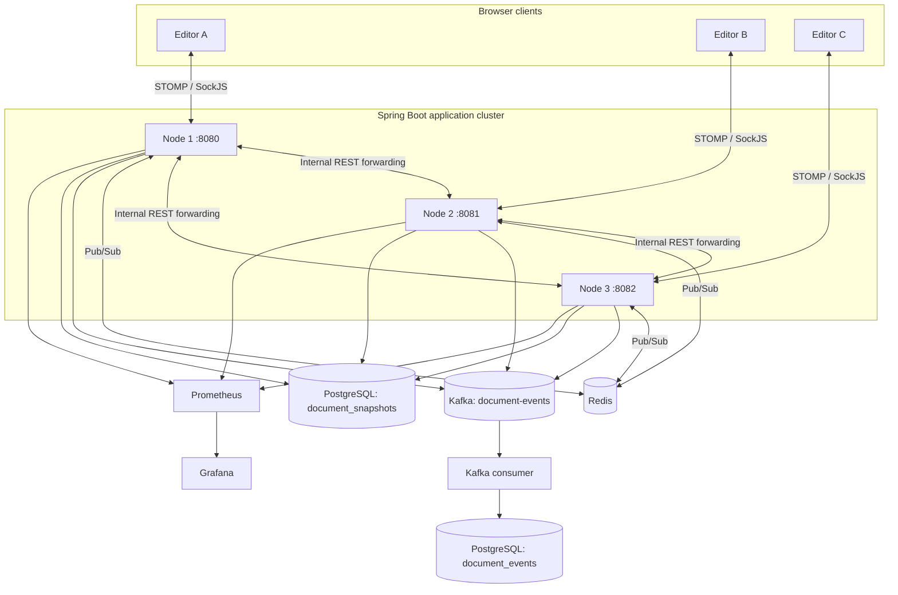
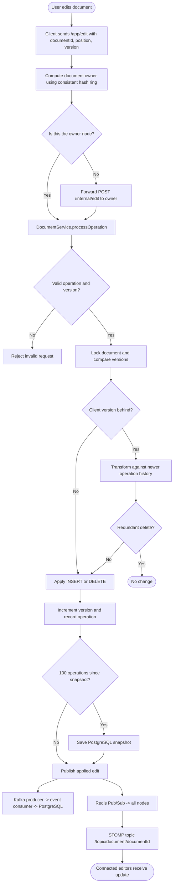
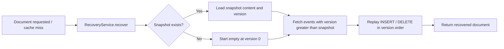
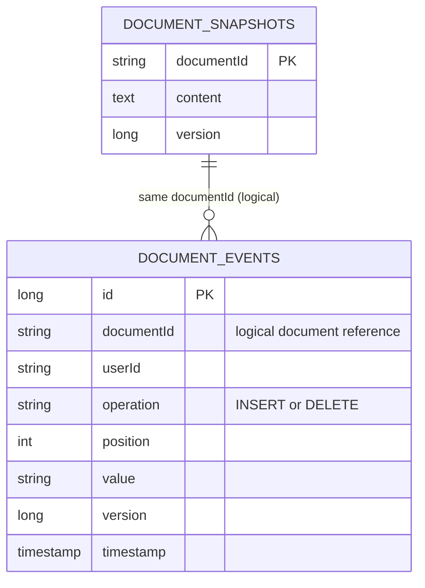

# Real-Time Collaborative Sync Engine

**Distributed, real-time collaborative document editing with Java 21, Spring Boot, WebSockets, Redis, Kafka, PostgreSQL, Docker, and Kubernetes.**

[](https://openjdk.org/) [](https://spring.io/projects/spring-boot) [](https://stomp.github.io/) [](https://docs.docker.com/compose/)

> **Repository note:** This README documents the **Real-Time Collaborative Sync Engine** codebase. If it is hosted in a repository named `Smart-Border-Surveillance-System-SBSS-`, that repository name is not the application's functionality.

## Contents

1. [Overview](#overview)
2. [Features and technology](#features-and-technology)
3. [System architecture](#system-architecture)
4. [End-to-end edit flowchart](#end-to-end-edit-flowchart)
5. [Database ER diagram](#database-er-diagram)
6. [Operational Transformation](#operational-transformation)
7. [Function and component walkthrough](#function-and-component-walkthrough)
8. [REST and WebSocket API](#rest-and-websocket-api)
9. [Project structure](#project-structure)
10. [Testing and monitoring](#testing-and-monitoring)
11. [Run locally — step by step](#run-locally--step-by-step)

## Overview

A collaborative editor must handle edits arriving simultaneously from different users and different application nodes. This project uses **Operational Transformation (OT)** to adjust stale edit positions, **consistent hashing** to assign each document to an authoritative node, **Redis Pub/Sub** to distribute updates to connected clients, and **Kafka + PostgreSQL** to retain an event history for recovery.

The system has three Spring Boot application nodes, a browser editor, real-time presence tracking, document snapshots, and monitoring. The supplied project documentation includes benchmark runs at 100, 250, and 500 concurrent users; these are **reported test results**, not a guarantee for every machine or deployment.

## Features and technology

| Feature | Implementation | Purpose |
| --- | --- | --- |
| Live editing | WebSocket, STOMP, SockJS | Send edits without polling |
| Concurrent edits | Operational Transformation | Rebase stale edits against newer edits |
| Document ownership | Consistent hash ring, 100 virtual nodes per physical node | Route edits to one authoritative owner |
| Cross-node fan-out | Redis Pub/Sub | Broadcast updates across all application nodes |
| Durable edit history | Kafka topic `document-events`, PostgreSQL | Persist applied edit events |
| Recovery | Snapshot + ordered event replay | Reconstruct document state after restart/cache miss |
| Presence | Session registry + reference-counted users | Track join/leave across multiple tabs |
| Monitoring | Micrometer, Prometheus, Grafana | Observe operations, active documents and JVM metrics |
| Deployment | Docker Compose, Kubernetes manifests | Run local cluster or container orchestration |

## System architecture



**Important distinction:** Redis distributes live notifications; Kafka transports durable event records; PostgreSQL stores event rows and periodic snapshots. Presence and active document state are maintained in memory.

## End-to-end edit flowchart



### Document recovery flow



## Database ER diagram

The persisted data model is an **event log plus a latest snapshot per document**. The diagram below reflects the fields described by the project's JPA entities. The link between the two tables is **logical through `documentId`**, not a claimed physical foreign-key constraint. Active users, sessions, and current documents are in-memory structures, not separate PostgreSQL tables in this codebase.



| Table | Responsibility | Important fields |
| --- | --- | --- |
| `document_snapshots` | Last stored full state for a document | `documentId` (PK), `content`, `version` |
| `document_events` | Ordered, replayable edit records | `id` (PK), `documentId`, `userId`, `operation`, `position`, `value`, `version`, `timestamp` |

**Recovery rule:** load the snapshot (if present), then fetch events for that `documentId` whose version is greater than the snapshot version, ordered ascending, and replay them. A document without a snapshot starts at version 0.

## Operational Transformation

When a client submits an edit based on an older document version, the server transforms it against edits already applied since that version.

| Incoming operation | Already applied operation | Adjustment |
| --- | --- | --- |
| INSERT | INSERT | Shift incoming position right by inserted text length if applied position is at/before it |
| INSERT | DELETE | Shift incoming position left by one if deletion was before it |
| DELETE | INSERT | Shift incoming position right by inserted text length if insertion was at/before it |
| DELETE | DELETE | If both target same position, make incoming delete a no-op; if prior deletion is earlier, shift left by one |

**Example:** Starting text `CAT`, Alice inserts `S` at position 0, making `SCAT`. Bob concurrently deletes `T` using the original version and position 2. The OT engine adjusts Bob's deletion to position 3, producing `SCA`. The document version advances as edits are applied.

## Function and component walkthrough

The following names and responsibilities are based on the project's published technical documentation. They cover the principal application methods and component entry points, rather than claiming to enumerate compiler-generated accessors or every private helper.

### Application and configuration

| Class/file | Function / responsibility |
| --- | --- |
| `BackendApplication.java` | Spring Boot application entry point; initializes application context |
| `WebSocketConfig.java` | Registers `/ws` SockJS endpoint, `/app` application prefix, STOMP broker topics |
| `RedisConfig.java` | Configures Redis channel `document-events` and listener container |
| `KafkaConfig.java` | Configures producer factory and `KafkaTemplate` for edit events |
| `WebClientConfig.java` | Provides `WebClient` for inter-node HTTP requests |
| `OpenApiConfig.java` | Publishes OpenAPI/Swagger metadata |

### Document editing and OT

| Class / method | What it does |
| --- | --- |
| `DocumentService.loadDocument(documentId)` | Returns cached document or calls recovery on a cache miss |
| `DocumentService.processOperation(message)` | Validates edit, serializes mutations per document, transforms stale edits, applies mutation, increments version, records history, triggers snapshots and metrics |
| `DocumentService.validateIncomingOperation(...)` | Checks operation parameters and bounds before applying an edit |
| `OperationTransformService.transform(incoming, applied)` | Dispatches to the appropriate transformation rule |
| `transformInsertAgainstInsert(...)` | Adjusts insert position after another insert |
| `transformInsertAgainstDelete(...)` | Adjusts insert position after a deletion |
| `transformDeleteAgainstInsert(...)` | Adjusts delete position after an insertion |
| `transformDeleteAgainstDelete(...)` | Adjusts or cancels a delete after another delete |
| `SnapshotService.saveSnapshot(document)` | Persists current text and version in PostgreSQL |
| `RecoveryService.recover(documentId)` | Rebuilds a document from snapshot and subsequent events |
| `RecoveryService.replay(...)` | Reapplies stored operations in ascending version order |

### Routing and cluster coordination

| Class / method | What it does |
| --- | --- |
| `ConsistentHashRing.init()` | Registers three physical nodes with 100 virtual nodes each |
| `ConsistentHashRing.hashFunc(key)` | Produces a hash position from MD5 |
| `ConsistentHashRing.getOwner(documentId)` | Resolves the authoritative node for a document |
| `RoutingService.forwardOperation(ownerAddress, message)` | Sends edit to owner via `POST /internal/edit` |
| `ClusterNode.java` | Holds node ID and address |
| `ClusterProperties.java` | Reads `cluster.node-id` and `cluster.node-address` |

### WebSocket and HTTP controllers

| Class / handler | What it does |
| --- | --- |
| `DocumentController` — `/app/join` | Registers user/session and broadcasts presence |
| `DocumentController` — `/app/edit` | Routes edit to owner or processes it; publishes Kafka and Redis events |
| `DocumentRestController` — `GET /document/{id}` | Returns document content and current version |
| `InternalDocumentController` — `POST /internal/edit` | Receives owner-routed edits and publishes resulting events |

### Messaging, persistence and presence

| Class / method | What it does |
| --- | --- |
| `DocumentEventProducer.publish(event)` | Sends applied edit to Kafka, keyed by document ID |
| `DocumentEventConsumer` — `@KafkaListener` | Reads Kafka events and saves `document_events` rows |
| `RedisPublisher` | Serializes and publishes an operation to Redis |
| `RedisSubscriber` | Receives Redis operation and broadcasts to local WebSocket subscribers |
| `DocumentSnapshotRepository` | Spring Data JPA CRUD for `document_snapshots` |
| `DocumentEventRepository.findByDocumentIdAndVersionGreaterThanOrderByVersionAsc(...)` | Loads ordered events needed for recovery |
| `PresenceService.join(docId, userId)` | Increments active connection count for a user |
| `PresenceService.leave(docId, userId)` | Decrements connection count; removes user at zero |
| `PresenceService.getUsers(docId)` | Returns online user IDs for a document |
| `PresenceService.totalUsers()` | Counts active users across documents |
| `SessionRegistry.register(sessionId, info)` | Associates WebSocket session with user and document |
| `SessionRegistry.get(sessionId)` | Retrieves session metadata |
| `SessionRegistry.remove(sessionId)` | Removes session metadata on disconnect |
| `WebSocketDisconnectListener.handleDisconnect(event)` | Cleans session/presence and broadcasts updated roster |
| `MetricsService` | Exposes `sync.operations.total` and `sync.documents.active` metrics |

### Data models and DTOs

| Model | Role |
| --- | --- |
| `Document` | Mutable in-memory text, version, recent history, snapshot counter |
| `OperationType` | `INSERT` / `DELETE` enum |
| `OperationMessage` | Incoming document ID, user ID, operation, position, value and base version |
| `AppliedOperation` | Historical applied operation for OT |
| `OperationResult` | Applied operation and new document version |
| `DocumentEditEvent` | Kafka event with timestamp |
| `DocumentEventEntity` | PostgreSQL event log JPA entity |
| `DocumentSnapshot` | PostgreSQL snapshot JPA entity |
| `JoinDocumentRequest` | Join payload containing document and user IDs |
| `PresenceResponse` | Current user roster |
| `RedisOperationEvent` | Redis Pub/Sub wrapper |
| `SessionInfo` | Session user/document mapping |
| `SyncResponse` | Full document content and version |

## REST and WebSocket API

### REST endpoints

| Method | Endpoint | Purpose |
| --- | --- | --- |
| GET | `/document/{id}` | Read document content and version |
| POST | `/internal/edit` | Forward edit to document owner (internal use) |
| GET | `/actuator/prometheus` | Prometheus metrics |
| GET | `/swagger-ui/index.html` | Interactive API documentation |

**Example read:**

```bash
curl http://localhost:8080/document/doc-1
```

**Example response:**

```json
{"documentId":"doc-1","content":"Hello World","version":42}
```

### STOMP over SockJS

- Connect to `http://localhost:8080/ws` (or node ports `8081` / `8082`).
- Send to `/app/join` to register presence.
- Send to `/app/edit` to submit edits.
- Subscribe to `/topic/document/{documentId}` for edits.
- Subscribe to `/topic/presence/{documentId}` for online users.

**Join payload:**

```json
{"documentId":"doc-1","userId":"alice"}
```

**Edit payload:**

```json
{
  "documentId": "doc-1",
  "userId": "alice",
  "operation": "INSERT",
  "position": 0,
  "value": "Hello",
  "version": 0
}
```

## Project structure

```text
.
├── .github/workflows/build.yml      # CI workflow
├── backend/
│   ├── pom.xml                     # Spring Boot dependencies
│   ├── Dockerfile                  # Java container image
│   ├── mvnw, mvnw.cmd              # Maven wrappers
│   └── src/
│       ├── main/
│       │   ├── java/com/cfs/backend/
│       │   │   ├── cluster/        # Consistent hashing and routing
│       │   │   ├── config/         # Spring configuration
│       │   │   ├── controller/     # HTTP and STOMP handlers
│       │   │   ├── dto/            # Transport and persistence DTOs
│       │   │   ├── kafka/          # Event producer and consumer
│       │   │   ├── listener/       # Disconnect listener
│       │   │   ├── Metrics/        # Micrometer metrics
│       │   │   ├── model/          # Document and operation models
│       │   │   ├── Redis/          # Redis publisher/subscriber
│       │   │   ├── repository/     # JPA repositories
│       │   │   └── service/        # OT, document, snapshot, recovery
│       │   └── resources/
│       │       ├── application.properties
│       │       ├── application-node2.properties
│       │       ├── application-node3.properties
│       │       └── static/index.html
│       └── test/                   # Unit and integration tests
├── docs/                           # Existing architecture/test images
├── k8s/                            # Kubernetes manifests
├── load-tests/                     # k6 and collaborative test scripts
├── docker-compose.yml              # Local infrastructure and app cluster
├── prometheus.yml                  # Metrics scraping
└── README.md
```

## Testing and monitoring

Run backend tests:

```bash
cd backend
./mvnw test
```

Run collaborative load test after the application is running:

```bash
cd load-tests/collaborative
npm install
node collab-edit-test.js
```

The repository also contains k6 HTTP/WebSocket scripts under `load-tests/`. Monitoring dashboards are available at **Prometheus** `http://localhost:9090` and **Grafana** `http://localhost:3000` when their containers are started. The project documents Grafana's development default login as `admin` / `admin`; change it outside a local test environment.

---

## Run locally — step by step

These instructions assume the repository root contains `docker-compose.yml` and the `backend/` directory. **Use Java 21 and Docker Desktop**. Maven 3.9+ is optional because a Maven wrapper is included. Node.js 18+ is needed only for collaborative load testing.

### 1. Clone the repository

```bash
git clone https://github.com/RambhuSingh1819/Smart-Border-Surveillance-System-SBSS-.git
cd Smart-Border-Surveillance-System-SBSS-
```

> If the project has not yet been pushed to that repository, use your existing local project directory instead. The clone URL above is the intended destination, not a guarantee that the remote has already been updated.

### 2. Verify prerequisites

```bash
java -version      # should show Java 21
./backend/mvnw -v  # Maven wrapper / Java information
docker --version
docker compose version
```

Start Docker Desktop before running Compose. Check that ports **8080–8082, 5432, 6379, 9092, 9090, and 3000** are available.

### 3. Start PostgreSQL, Redis, Kafka, and monitoring

From the repository root:

```bash
docker compose up -d postgres redis zookeeper kafka prometheus grafana
docker compose ps
```

Wait until infrastructure containers are running and healthy. The supplied Compose file uses ZooKeeper-backed Kafka; the separate Kubernetes manifests use KRaft Kafka.

### 4. Start the Spring Boot nodes

Open **three separate terminals**. In each, navigate to the repository's `backend` directory. Run:

**Terminal A — Node 1**

```bash
cd backend
./mvnw spring-boot:run
```

**Terminal B — Node 2**

```bash
cd backend
./mvnw spring-boot:run -Dspring-boot.run.profiles=node2
```

**Terminal C — Node 3**

```bash
cd backend
./mvnw spring-boot:run -Dspring-boot.run.profiles=node3
```

On Windows, use `mvnw.cmd` instead of `./mvnw`. If you have Maven installed, you may use `mvn` in place of the wrapper.

> **Networking caveat:** The existing configuration uses cluster node addresses and infrastructure hostnames. If starting the Java processes on your host instead of in Docker, verify `backend/src/main/resources/application*.properties` for PostgreSQL, Redis, Kafka, and inter-node URLs. Container hostnames such as `postgres`, `redis`, and `kafka` generally need `localhost` or host-accessible addresses for processes running directly on your laptop. Do not commit passwords or secrets.

### 5. Open the editor

- Node 1: http://localhost:8080
- Node 2: http://localhost:8081
- Node 3: http://localhost:8082
- Swagger: http://localhost:8080/swagger-ui/index.html
- Prometheus: http://localhost:9090
- Grafana: http://localhost:3000

Open two tabs, preferably on different node ports. Join the **same document ID** with different user IDs. Type in one editor and check that the other receives the changes. Also try simultaneous inserts and deletions.

### 6. Verify document persistence

```bash
curl http://localhost:8080/document/doc-1
```

Confirm the response contains `documentId`, `content`, and `version`. Generate edits and inspect logs/metrics. Snapshots are triggered after every **100 applied operations per document** in the documented service logic.

### 7. Stop the application

Stop each Spring Boot terminal with **Ctrl+C**. From the repository root, stop infrastructure containers:

```bash
docker compose down
```

`docker compose down` does not delete named volumes by default. **Do not add `-v`** unless you intentionally want to remove persisted local database data.

### Optional: Run everything through Docker Compose

The supplied `docker-compose.yml` also defines `app`, `app2`, and `app3` services. If the container build and networking configuration are valid on your machine, you can instead run:

```bash
docker compose up -d --build
docker compose ps
```

This is an alternative to manually starting the three Java processes; **do not run both approaches at the same time on the same ports**.

---

**Maintainer:** [RambhuSingh1819](https://github.com/RambhuSingh1819) · **Project:** Real-Time Collaborative Sync Engine
